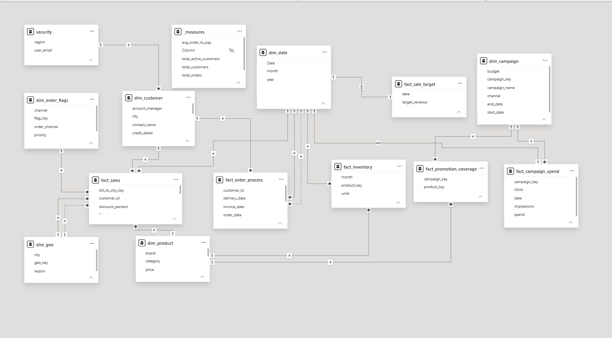

# Power BI Data Model — Messy Data Cleanup

A Power BI project built from an intentionally messy, multi-source practice
dataset (order management, campaigns, inventory, and finance data spread
across 22 raw source tables with inconsistent formats, broken headers, and
duplicate records). The goal was to design a clean star schema and resolve
real data-quality problems along the way.

## Source data (01_Stage)

22 raw tables, including Address, CAMPAIGN_LOG, campaign_skus, cities,
CUST_MASTER, customer_contacts, exchange_rates, invoice_lines, inventory,
INVOICES, order_line_items, ORDERS_2025, ORDERS_2026, payments, products,
regions, sales_targets, shipments, subcategories, user_details, orders.

Several of these arrived with generic headers (Column1, Column2...),
inconsistent casing, and duplicate rows, which were cleaned in Power Query
before being modeled.

## Final model — star schema

**Dimensions:** dim_customer, dim_product, dim_order_flags, dim_geo,
dim_campaign

**Facts:** fact_sale_target, fact_order_process, fact_inventory, fact_sales,
fact_campaign_spend, fact_promotion_coverage

## Key data-quality fixes

- **Broken headers:** Several source tables (e.g. campaign_skus, cities,
  exchange_rates) had generic `Column1/Column2` headers instead of real
  field names. Fixed via Promote Headers / manual renaming before further
  transformation.
- **Merge fan-out in fact_order_process:** Orders with multiple shipment
  or payment records were producing duplicate rows (a 2×2 cartesian
  product) when merged directly. Fixed by grouping `shipments` and
  `payments` to one row per order (latest date) *before* merging, since
  fact_order_process is modeled at one-row-per-order grain.
- **Duplicate rows:** Removed exact duplicates from several source tables
  (e.g. dim_campaign, dim_geo) using Remove Duplicates.
- **Unpivoted inventory:** Source inventory data was stored wide (one
  column per month); reshaped into a proper long/tidy fact_inventory
  table using Unpivot Columns.

## Excluded from the model

- **exchange_rates** — all payments in the source data use a single
  currency, so currency conversion isn't needed for this analysis.

## Notes

This is practice/course data, not a real production dataset. The focus
of this project is the modeling and cleanup process, not the business
conclusions.

